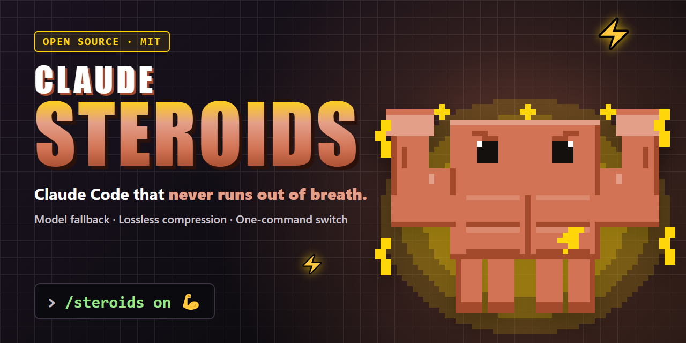
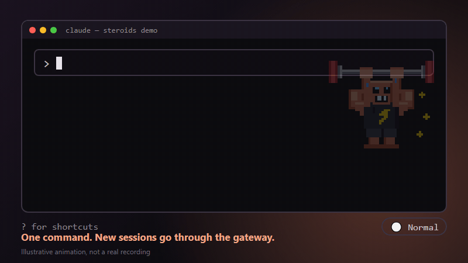
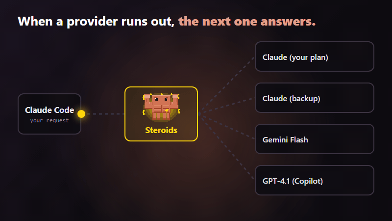
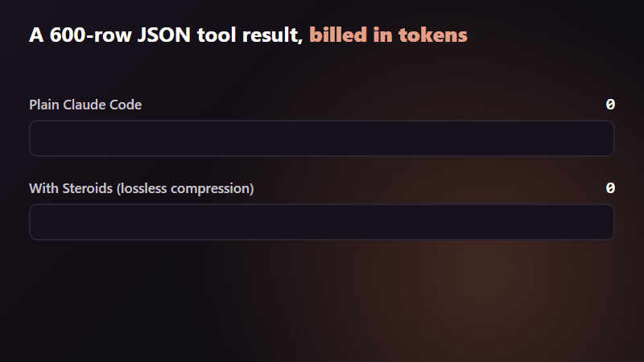

<div align="center">



# Claude Steroids 💪

**Claude Code al que nunca se le acaba el aire.**
Un comando pone un gateway local entre Claude Code y tus modelos: respaldo automático cuando un proveedor se agota, compresión sin pérdida de los resultados grandes de herramientas, una cadena de modelos por rol y una insignia que te dice en qué modo estás.

[English](README.md) · [Español](README.es.md)

  

</div>

> **Proyecto no oficial de fans.** Sin afiliación, respaldo ni patrocinio de Anthropic. "Claude" y "Claude Code" son marcas de Anthropic. La mascota es un dibujo pixel-art original inspirado en el personaje naranja de Claude Code.

---

## ¿Qué es?

Claude Steroids es un **mod de Claude Code** (un plugin de hooks con funciones) más un pequeño script de instalación y una configuración recomendada. Hace cuatro cosas:

1. **`/steroids on|off|status`** cambia las sesiones nuevas de Claude Code para que pasen por [OmniRoute](https://github.com/diegosouzapw/OmniRoute), un gateway local, y las devuelve a la conexión normal.
2. **Cadenas de respaldo.** Cada uno de los tres alias de modelo de Claude Code (`opus`, `sonnet`, `haiku`) apunta a su propia cadena: primero tu plan de Claude, luego el siguiente proveedor que conectaste, y así.
3. **Compresión sin pérdida** de los resultados estructurados grandes de herramientas (JSON, tablas) antes de que se facturen como tokens.
4. **Buenos hábitos incluidos:** una insignia en el pie del prompt, un recordatorio para usar tus plugins y una regla opcional para que los commits nunca lleven `Co-Authored-By`.

**No** hace a Claude más listo. Hace tu entorno más difícil de detener y algo más barato con datos estructurados.

## Claude Code normal vs. con Steroids

| | Claude Code normal | Con Steroids |
|---|---|---|
| Llegas al límite de tu Claude | Esperas al reinicio | La petición pasa al siguiente modelo de tu cadena *(cada eslabón verificado; un agotamiento real aún no lo he visto, ver [Limitaciones](#limitaciones-y-honestidad))* |
| Varias terminales con roles distintos | Un modelo cada vez, cambiado a mano | `opus` / `sonnet` / `haiku` apuntan cada uno a su cadena: un líder + constructores funciona sin más |
| 600 filas de JSON devueltas por una herramienta | Se factura completo | **−47 %** de tokens de entrada, datos intactos ([medido](#resultados-medidos)) |
| Salida de `git log` y `ls` | Se factura completo | Se factura completo (**~0 %**, lo medí) |
| ¿En qué modo estoy? | Abrir `settings.json` | Insignia `💪 Steroids` / `⚪ Normal` en el pie del prompt |
| Activar o desactivar todo | Editar `settings.json` a mano | `/steroids on` o `/steroids off` |
| Mensajes de commit | `Co-Authored-By: Claude` por defecto | Una pregunta al instalar y una regla en `CLAUDE.md` |
| Usar tus plugins | El modelo decide, a menudo que no | Un recordatorio en el prompt de sistema y reglas en `CLAUDE.md` |

## Míralo funcionar

*Animaciones ilustrativas de comportamiento medido, no grabaciones de pantalla.*

### 1 · Un comando para cambiar

<p align="center"></p>

### 2 · Cuando un proveedor se agota, responde el siguiente

<p align="center"></p>

### 3 · Menos tokens en resultados estructurados grandes

<p align="center"></p>

## Instalación rápida (unos 5 minutos)

Necesitas: **Node 22.22.2 o superior**, **Claude Code 2.1+** y al menos un proveedor de modelos al que puedas iniciar sesión (tu plan de Claude, Gemini, GitHub Copilot...).

```bash
# 1. Descárgalo
git clone https://github.com/Sam-SSD/Claude-Steroids-Mod
cd Claude-Steroids-Mod

# 2. Instala: copia el switch, instala el plugin y pregunta antes de tocar CLAUDE.md / settings.json
node setup/setup.mjs install --with=ponytail,frontend-design     # --with es opcional

# 3. Arranca el gateway y abre su panel
omniroute serve --daemon          # http://localhost:20128
```

4. En el panel: **conecta tus proveedores** y **crea una API key**. Eso necesita tus cuentas, así que ningún script puede hacerlo por ti. Pega la clave en `~/.claude/steroids/steroids.json` (`"apiKey"`). Edita ahí las `chains` según los modelos que tus cuentas pueden usar (`omniroute models` los lista).

```bash
# 5. Crea los tres combos, prueba cada uno y activa la compresión
node setup/setup.mjs combos
```

Luego, dentro de Claude Code:

```
/steroids on
```

Abre una sesión **nueva**. El pie muestra `💪 Steroids`. Listo.

> ¿Solo quieres el plugin? En Claude Code: `/plugin install steroids --marketplace Sam-SSD/Claude-Steroids-Mod`. Eso instala solo el mod; `/steroids on` además necesita `~/.claude/steroids/toggle.js` y `steroids.json`, que crea el paso 2.

> ¿Prefieres un botón en el escritorio? Copia `setup/shortcuts/Steroids ON.bat` y `Steroids OFF.bat` a tu escritorio (Windows).

## Ejemplos de uso

**Activar y comprobar**
```
/steroids on        → escribe el gateway en settings.json (tras una prueba de punta a punta)
/steroids status    → "Esta sesión: conexión normal. Sesiones nuevas: usarán Steroids."
```
Las sesiones ya abiertas conservan la conexión con la que arrancaron; abre una nueva.

**Se acaba tu plan en mitad del proyecto.** Claude Code pide `opus`; Steroids lo manda a `steroids-opus`, una cadena por prioridad: `claude-opus-5-5 → el Claude de otro proveedor → Gemini → Copilot`. Si el primero rechaza, OmniRoute prueba el siguiente. Sigues trabajando, quizá con un modelo más débil.

**Una herramienta devuelve un JSON grande.** Una llamada a una API o una consulta a una base de datos devuelve 600 filas. Con la compresión activa, Claude factura ~47 % menos de tokens de entrada por ese resultado y sigue encontrando el dato escondido (`bench/compress-json.mjs` lo demuestra en tu equipo).

**Líder + constructores.** Abre cuatro terminales: una en `opus`, dos en `sonnet`, una en `haiku`. Cada alias tiene su cadena, así que el líder y los constructores caen de forma independiente.

**Commits limpios.** `claude -p "haz commit de a.txt"` crea el commit con tu identidad de `git config`, sin el trailer `Co-Authored-By` (probado en 4 commits reales).

## Qué cambia en tu equipo

| Dónde | Qué |
|---|---|
| `~/.claude/steroids/` | `toggle.js` (el switch) y `steroids.json` (tu clave y cadenas, **nunca lo subas a git**) |
| `~/.claude/settings.json` | `/steroids on` añade `ANTHROPIC_BASE_URL`, `ANTHROPIC_AUTH_TOKEN`, `ANTHROPIC_DEFAULT_*_MODEL`; `off` los quita. Cada vez se escribe una copia `settings.json.bak-steroids` |
| OmniRoute | Tres combos `steroids-opus/sonnet/haiku` y un preset de compresión sin pérdida (tu ajuste anterior se guarda y `compression off` lo restaura) |
| `~/.claude/CLAUDE.md` *(opcional)* | Un bloque entre los marcadores `<!-- steroids:plugins -->` |

Cómo funciona por dentro: [docs/how-it-works.md](docs/how-it-works.md) *(en inglés)*. ¿Algo falla? [docs/troubleshooting.md](docs/troubleshooting.md) *(en inglés)*.

## Resultados medidos

Mismo prompt, mismo modelo (Haiku), tokens de entrada facturados por Claude. Reprodúcelo con `node setup/setup.mjs compression off|on` y `node bench/compress-json.mjs`.

| Resultado de herramienta | Compresión off | Compresión on | Dato recuperado |
|---|---|---|---|
| JSON de 600 filas (`bench/compress-json.mjs`) | 29.351 | **15.586 (−46,9 %)** | sí, en las dos ejecuciones |
| `git log --stat` (120 KB) | 57.535 | 57.535 (0 %) | sí |
| `ls -laR` (100 KB) | 68.180 | 68.180 (0 %) | sí |

Las dos últimas filas salen de una prueba rápida suelta que no está en este repo. Los archivos de código no se midieron con el motor de OmniRoute. Detalles y salvedades: [docs/benchmarks.md](docs/benchmarks.md) *(en inglés)*.

## Limitaciones y honestidad

- **Un agotamiento real de cuota no lo he observado.** Verifiqué que cada eslabón de mi cadena responde y puede llamar herramientas, y vi cómo los modelos agotados devuelven sus errores de cuota. Aún no he visto un salto completo de Claude al respaldo dentro de un combo, así que esa parte se apoya en la estrategia `priority` documentada de OmniRoute.
- **Cambiar de modelo a mitad de tarea cambia la calidad.** Un modelo de respaldo suele ser más débil que tu primera opción.
- **Los conectores de claude.ai quedan desactivados mientras Steroids está activo** (Drive, Docs, Slides...). Claude Code lo hace siempre que `ANTHROPIC_AUTH_TOKEN` está definido. `/steroids off` los devuelve en sesiones nuevas.
- **Términos de servicio.** Enrutar tu *suscripción* de Claude a través de un gateway de terceros puede no estar permitido por los términos de tu plan. Revísalos o usa una API key.
- **Solo sesiones nuevas.** Una sesión abierta nunca cambia de conexión.
- **Aviso en el log:** `unrecognized_model steroids-opus[1m]`. Es inofensivo; el sufijo `[1m]` solo indica un contexto de 1M.
- **Probado solo en Windows 10**, Claude Code 2.1.319, OmniRoute 3.8.53, Node 22.23.4. macOS y Linux deberían funcionar (las rutas son portables) pero no están probados.
- **API en acceso anticipado.** La API de plugins de hooks de Claude Code puede cambiar entre versiones.
- La API key queda en texto plano en dos archivos locales. Mantén OmniRoute escuchando solo en `localhost`.
- Consejo para Windows: los comandos de hooks escritos con barras invertidas fallan en Git Bash (`command not found`). Usa barras normales.

## Desinstalar

```bash
# dentro de Claude Code
/steroids off
claude plugin uninstall steroids@claude-steroids
claude plugin marketplace remove claude-steroids
# después
node setup/setup.mjs compression off      # restaura la compresión previa de OmniRoute
npm rm -g omniroute                       # opcional
rm -r ~/.claude/steroids                  # opcional
```
Quita el bloque entre los marcadores `steroids:plugins` de `~/.claude/CLAUDE.md`, o restaura `CLAUDE.md.bak-steroids` / `settings.json.bak-steroids`.

## Preguntas frecuentes

**¿Necesito todos los proveedores?** No. Con uno basta; los respaldos solo importan si conectas más.
**¿Manda mi código a algún sitio nuevo?** Las peticiones van a los proveedores que *tú* conectaste, a través de un gateway que corre en tu equipo.
**¿Puedo usarlo sin los plugins que mencionas?** Sí. `--with` es opcional y `plugins` en `steroids.json` puede estar vacío.
**Mis modelos tienen otros nombres.** Ejecuta `omniroute models`, edita `chains` en `steroids.json` y vuelve a lanzar `node setup/setup.mjs combos`.

## Créditos

[OmniRoute](https://github.com/diegosouzapw/OmniRoute) hace el enrutado y la compresión; este repo solo lo conecta a Claude Code y documenta cómo. Plugins mencionados: [ponytail](https://github.com/DietrichGebert/ponytail), `frontend-design`, [MemPalace](https://github.com/MemPalace/mempalace).

## Licencia

[MIT](LICENSE) © Sam-SSD
