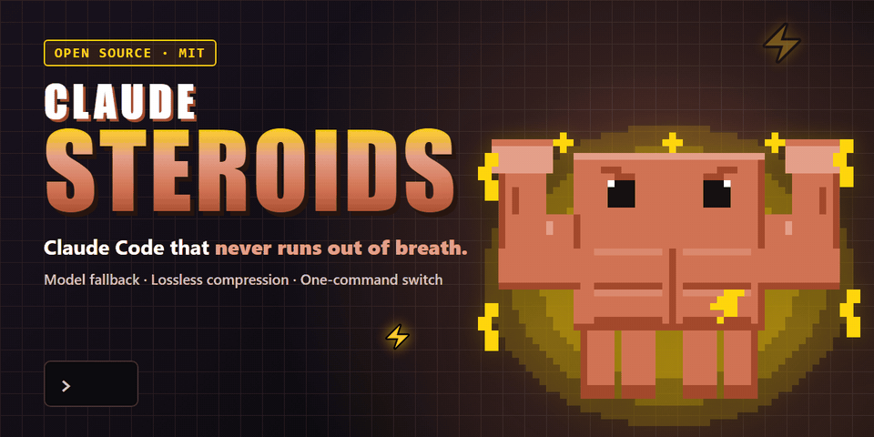
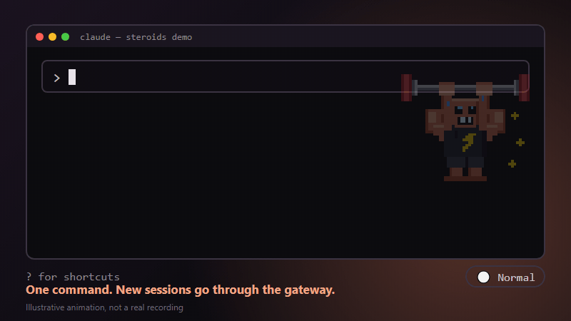
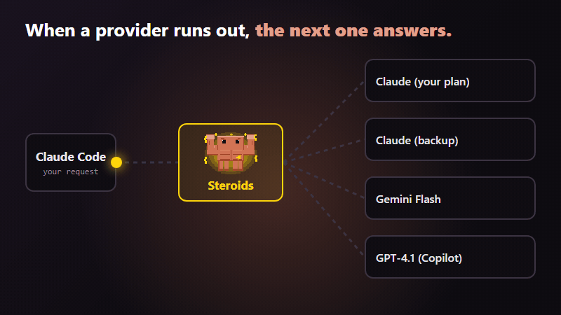
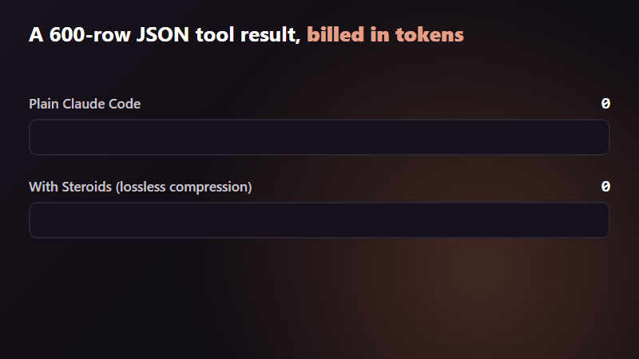

<div align="center">



# Claude Steroids 💪

**Claude Code that never runs out of breath.**
One command puts a local gateway between Claude Code and your models: automatic fallback when a provider runs out, lossless compression of big tool results, one model chain per role, and a badge that tells you which mode you are in.

[English](README.md) · [Español](README.es.md)

   [](https://github.com/Sam-SSD/Claude-Steroids-Mod/actions/workflows/smoke.yml)

</div>

> **Unofficial fan project.** Not affiliated with, endorsed by or sponsored by Anthropic. "Claude" and "Claude Code" are Anthropic's trademarks. The mascot is an original pixel-art drawing inspired by Claude Code's orange character.

---

## What is this?

Claude Steroids is a **Claude Code mod** (a function-hooks plugin) plus a small setup script and a recommended configuration. It does four things:

1. **`/steroids on|off|status`** switches new Claude Code sessions to run through [OmniRoute](https://github.com/diegosouzapw/OmniRoute), a local gateway, and back.
2. **Fallback chains.** Each of Claude Code's three model aliases (`opus`, `sonnet`, `haiku`) points to its own chain of models: your Claude plan first, then the next provider you connected, and so on.
3. **Lossless compression** of large structured tool results (JSON, tables) before they are billed as tokens.
4. **Good habits baked in:** a badge in the prompt footer, a reminder to use your plugins, and an optional rule so commits never carry a `Co-Authored-By` line.

It does **not** make Claude smarter. It makes your setup harder to stop and a bit cheaper on structured data.

## Normal Claude Code vs. with Steroids

| | Normal Claude Code | With Steroids |
|---|---|---|
| Your Claude limit is reached | You wait for the reset | The request moves to the next model in your chain *(each link verified; a real quota exhaustion has not yet been observed, see [Limitations](#limitations-and-honesty))* |
| Several terminals with different roles | One model at a time, switched by hand | `opus` / `sonnet` / `haiku` each map to their own chain, so a leader + builders layout just works |
| 600-row JSON returned by a tool | Billed in full | **−47 %** input tokens, data intact ([measured](#measured-results)) |
| `git log` and `ls` output | Billed in full | Billed in full (**~0 %**, I measured it) |
| Which mode am I in? | Open `settings.json` | Badge `💪 Steroids` / `⚪ Normal` in the prompt footer |
| Turn the whole thing on or off | Edit `settings.json` by hand | `/steroids on` or `/steroids off` |
| Commit messages | `Co-Authored-By: Claude` by default | One question at install time and one `CLAUDE.md` rule |
| Using your plugins | The model decides, often not to | A reminder in the system prompt plus `CLAUDE.md` rules |

## See it work

*Illustrative animations of measured behaviour, not screen recordings.*

### 1 · One command to switch

<p align="center"></p>

### 2 · When a provider runs out, the next one answers

<p align="center"></p>

### 3 · Fewer tokens on big structured results

<p align="center"></p>

## Install (about 5 minutes)

Works on **Windows, macOS and Linux**. Pick your system in step 1; everything else is the same.

### 1 · Prerequisites

| | Windows 10 / 11 | macOS 13+ | Linux (Ubuntu 20.04+, Debian 10+, Alpine 3.19+) |
|---|---|---|---|
| **Node.js ≥ 22.22.2** | `winget install OpenJS.NodeJS.22` | `brew install node@22` | `nvm install 22` ([nvm](https://github.com/nvm-sh/nvm)) or your package manager |
| **Git** | `winget install Git.Git` | `xcode-select --install` | `sudo apt install git` |
| **Claude Code 2.1+** | `winget install Anthropic.ClaudeCode` | `brew install --cask claude-code` | native installer or `npm install -g @anthropic-ai/claude-code` (no `sudo`) |
| A model provider you can log into | your Claude plan, Gemini, GitHub Copilot... | same | same |

All the ways to install Claude Code are in the [official setup guide](https://code.claude.com/docs/en/setup). Check what you have:

```bash
node -v          # must be v22.22.2 or newer
claude --version
```

### 2 · Get Steroids and run the installer

Same on every system:

```bash
git clone https://github.com/Sam-SSD/Claude-Steroids-Mod
cd Claude-Steroids-Mod
node setup/setup.mjs install --with=ponytail,frontend-design     # --with is optional, add --dry to preview
```

It copies the switch to `~/.claude/steroids/`, installs the plugin and **asks before** touching `CLAUDE.md` or `settings.json` (it writes a `.bak-steroids` backup first).

### 3 · Start the gateway

```bash
omniroute serve --daemon          # dashboard at http://localhost:20128
```

- `omniroute: command not found`: on **Windows** open a new terminal; on **macOS/Linux** run `export PATH="$(npm prefix -g)/bin:$PATH"` and add that line to your shell profile.
- `EACCES` while installing with npm: do **not** use `sudo`. Use nvm (it installs Node in your home folder) or `npm config set prefix ~/.npm-global`.

### 4 · Connect your providers and paste your key

In the dashboard, **connect your providers** and **create an API key**. That needs your accounts, so no script can do it for you. Paste the key in the config file:

| System | Config file |
|---|---|
| Windows | `%USERPROFILE%\.claude\steroids\steroids.json` |
| macOS / Linux | `~/.claude/steroids/steroids.json` |

Edit `chains` there to match the models your accounts can use (`omniroute models` lists them).

### 5 · Create the combos and switch on

```bash
node setup/setup.mjs combos       # creates the three combos, tests each one, turns compression on
```

Then, inside Claude Code:

```
/steroids on
```

Open a **new** session. The footer shows `💪 Steroids`. Done.

### Optional: a button instead of a command

| System | What to use |
|---|---|
| Windows | Copy `setup/shortcuts/Steroids ON.bat` and `Steroids OFF.bat` to your desktop. |
| macOS | Copy `setup/shortcuts/Steroids ON.command` and `Steroids OFF.command` somewhere handy, run `chmod +x` on them once, then double-click. The first time, right-click → Open. |
| Linux | Use `setup/shortcuts/steroids-on.sh` and `steroids-off.sh` (`chmod +x` once, run from a terminal). For a launcher icon, create a `.desktop` file with `Exec=sh -c '/path/to/steroids-on.sh'` and `Terminal=true`. |

> Only want the plugin? In Claude Code: `/plugin install steroids --marketplace Sam-SSD/Claude-Steroids-Mod`. That installs the mod alone; `/steroids on` also needs `~/.claude/steroids/toggle.js` and `steroids.json`, which step 2 creates.

### How well is each system tested?

| System | What was checked |
|---|---|
| **Windows 10** | Everything, by hand: Claude Code 2.1.319, OmniRoute 3.8.53 and the mod in real sessions. |
| **Windows, macOS and Linux** (Node 22 and 24) | Automated on every push ([smoke test](https://github.com/Sam-SSD/Claude-Steroids-Mod/actions/workflows/smoke.yml)): the switch (`on`, `off`, `ensure`, and a wrong key leaves your settings untouched) against a mock gateway, the installer dry run and the config files. |
| **macOS and Linux with a real Claude Code and OmniRoute** | **Not tested by me.** The code uses no OS-specific calls apart from the shortcuts, but I have not run the whole thing there. If it breaks, please [open an issue](https://github.com/Sam-SSD/Claude-Steroids-Mod/issues). |

## Usage examples

**Turn it on and check**
```
/steroids on        → writes the gateway into settings.json (after an end-to-end test)
/steroids status    → "This session: normal connection. New sessions: will use Steroids."
```
Sessions that are already open keep the connection they started with; open a new one.

**Your plan runs out mid-project.** Claude Code asks for `opus`; Steroids sends it to `steroids-opus`, a priority chain: `claude-opus-5-5 → another provider's Claude → Gemini → Copilot`. If the first one refuses, OmniRoute tries the next. You keep working, possibly on a weaker model.

**A tool returns a big JSON.** An API call or a database query returns 600 rows. With compression on, Claude is billed ~47 % fewer input tokens for that result and still finds the needle in it (`bench/compress-json.mjs` proves it on your machine).

**Leader + builders.** Open four terminals: one on `opus`, two on `sonnet`, one on `haiku`. Each alias has its own chain, so the leader and the builders can fall back independently.

**Clean commits.** `claude -p "commit a.txt"` creates the commit under your own `git config` identity, with no `Co-Authored-By` trailer (tested over 4 real commits).

## What it changes on your machine

| Where | What |
|---|---|
| `~/.claude/steroids/` | `toggle.js` (the switch) and `steroids.json` (your key and chains, **never commit it**) |
| `~/.claude/settings.json` | `/steroids on` adds `ANTHROPIC_BASE_URL`, `ANTHROPIC_AUTH_TOKEN`, `ANTHROPIC_DEFAULT_*_MODEL`; `off` removes them. A backup `settings.json.bak-steroids` is written every time |
| OmniRoute | Three combos `steroids-opus/sonnet/haiku` and a lossless compression preset (your previous setting is saved and `compression off` restores it) |
| `~/.claude/CLAUDE.md` *(optional)* | A marked block between `<!-- steroids:plugins -->` markers |

How it works in detail: [docs/how-it-works.md](docs/how-it-works.md). Something broke? [docs/troubleshooting.md](docs/troubleshooting.md).

## Measured results

Same prompt, same model (Haiku), input tokens billed by Claude. Reproduce with `node setup/setup.mjs compression off|on` and `node bench/compress-json.mjs`.

| Tool result | Compression off | Compression on | Needle recovered |
|---|---|---|---|
| 600-row JSON (`bench/compress-json.mjs`) | 29,351 | **15,586 (−46.9 %)** | yes, both runs |
| `git log --stat` (120 KB) | 57,535 | 57,535 (0 %) | yes |
| `ls -laR` (100 KB) | 68,180 | 68,180 (0 %) | yes |

The last two rows came from a quick ad-hoc test that is not in this repo. Code files were not measured with OmniRoute's engine. Details and caveats: [docs/benchmarks.md](docs/benchmarks.md).

## Limitations and honesty

- **Real quota exhaustion has not been observed.** I verified that every link of my chain answers and can call tools, and I saw exhausted models return their quota errors. I have not yet watched a complete Claude → fallback switch happen on its own inside a combo, so that part relies on OmniRoute's documented `priority` strategy.
- **Switching models mid-task changes quality.** A fallback model is usually weaker than your first choice.
- **claude.ai connectors are disabled while Steroids is on** (Drive, Docs, Slides...). Claude Code does that whenever `ANTHROPIC_AUTH_TOKEN` is set. `/steroids off` brings them back in new sessions.
- **Terms of service.** Routing your Claude *subscription* through a third-party gateway may not be allowed by your plan's terms. Check them, or use an API key.
- **New sessions only.** An open session never changes connection.
- **Warning in the log:** `unrecognized_model steroids-opus[1m]`. It is harmless; the `[1m]` suffix is only a hint of a 1M context.
- **Tested by hand only on Windows 10** (Claude Code 2.1.319, OmniRoute 3.8.53, Node 22.23.4). macOS and Linux are covered by automated smoke tests, not by a real Claude Code session: see [How well is each system tested?](#how-well-is-each-system-tested).
- **Early-access API.** Claude Code's function-hooks plugin API may change between releases.
- The API key sits in plain text in two local files. Keep OmniRoute bound to `localhost`.
- Windows tip: hook commands written with backslashes fail under Git Bash (`command not found`). Use forward slashes.

## Uninstall

```bash
# in Claude Code
/steroids off
claude plugin uninstall steroids@claude-steroids
claude plugin marketplace remove claude-steroids
# then
node setup/setup.mjs compression off      # restore OmniRoute's previous compression
npm rm -g omniroute                       # optional
rm -rf ~/.claude/steroids                 # optional (PowerShell: Remove-Item -Recurse -Force "$HOME.claudesteroids")
```
Remove the block between the `steroids:plugins` markers in `~/.claude/CLAUDE.md`, or restore `CLAUDE.md.bak-steroids` / `settings.json.bak-steroids`.

## FAQ

**Do I need all the providers?** No. One provider is enough; fallbacks only matter if you connect more.
**Does it send my code anywhere new?** Requests go to the providers *you* connected, through a gateway running on your machine.
**Can I use it without the plugins you mention?** Yes. `--with` is optional and `plugins` in `steroids.json` can be empty.
**I use Claude Code inside WSL.** Install everything inside WSL and follow the Linux column. Not tested by me.
**My models have different names.** Run `omniroute models` and edit `chains` in `steroids.json`, then `node setup/setup.mjs combos` again.

## Credits

[OmniRoute](https://github.com/diegosouzapw/OmniRoute) does the routing and the compression; this repo only wires it into Claude Code and documents how. Plugins mentioned: [ponytail](https://github.com/DietrichGebert/ponytail), `frontend-design`, [MemPalace](https://github.com/MemPalace/mempalace).

## License

[MIT](LICENSE) © Sam-SSD
